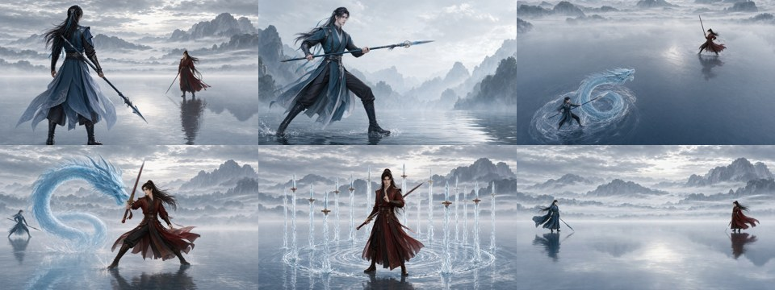
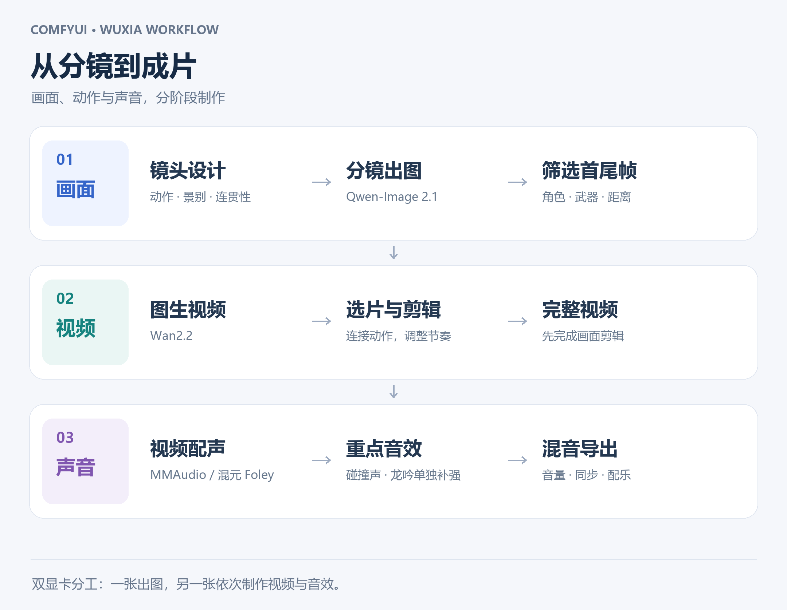

# ComfyUI Wuxia Pipeline

**双显卡武侠短片制作工作流**

Storyboard → Video Generation → Sound Design

[快速开始](docs/QUICKSTART.md) · [工作流下载](#工作流) · [制作流程](#制作流程) · [模型与节点](docs/QUICKSTART.md) · [致谢](#致谢)



将 Qwen-Image 2.1、Wan2.2、MMAudio 与 HunyuanVideo-Foley 串联成分阶段制作流程，覆盖角色分镜、镜头动画、整片配声和关键音效分层。提供 **6 个 ComfyUI 工作流示例**，可按制作阶段独立使用。

## 核心能力

| 画面设计 | 镜头生成 | 声音设计 |
| --- | --- | --- |
| 参考图驱动的角色分镜 | 首尾帧与单图两种视频工作流 | MMAudio 与混元 Foley 视频配声 |
| 筛选角色、武器和场景关系 | 衔接动作、切换景别、调整节奏 | 环境底声与关键事件音效分层 |

**双显卡分工**：一张显卡负责分镜出图，另一张依次负责视频与音效制作。各阶段使用独立工作流，便于迭代画面、动作和声音。

## 制作流程



**设计分镜 → 生成片段 → 筛选与剪辑 → 整片配声 → 重点音效 → 混音导出**

武侠场景示例：蓝衣出招 → 俯拍水龙进攻 → 近景红衣格挡 → 反击 → 远景对望收势。先确定画面节奏，再为碰撞、龙吟等关键事件添加独立音效。

## 工作流

| 阶段 | 工作流 | 内容 |
| --- | --- | --- |
| 分镜 | [Qwen 参考图出图](workflows/image/01_qwen_storyboard.json) | 角色与场景分镜 |
| 视频 | [Wan 首尾帧控制](workflows/video/01_wan_first_last.json) | 从起始画面衔接到目标画面 |
| 视频 | [Wan 图生视频](workflows/video/02_wan_image_to_video.json) | 从单张画面生成镜头动作 |
| 音效 | [MMAudio 视频配声](workflows/audio/01_mmaudio_video_sfx.json) | 视频引导的环境与动作音效 |
| 音效 | [Hunyuan Foley 视频配声](workflows/audio/02_hunyuan_video_sfx.json) | 混元 Foley 音效生成 |
| 混音 | [关键音效分层](workflows/audio/03_key_sfx_layers.json) | 碰撞声、龙吟与视频底声叠加 |

## 快速开始

1. 按 [模型与节点准备清单](docs/QUICKSTART.md) 配置所需的 ComfyUI 节点和模型。
2. 下载所选 JSON，拖入 ComfyUI，上传自己的参考图或视频。
3. 选择模型，调整提示词和片段长度，生成并筛选镜头。
4. 完成画面剪辑后导入视频配声；调整重点音效的时间与音量，混音并导出。

画面筛选与剪辑由创作者完成；分层模板中的时间点需匹配自己的镜头。配乐可作为独立音轨加入。

## 仓库结构

```text
assets/        分镜预览与流程图
docs/          模型、节点与输入准备
workflows/     分镜、视频与音效 JSON
```

## 致谢

本项目基于 [ComfyUI](https://github.com/Comfy-Org/ComfyUI)、[Qwen-Image](https://github.com/QwenLM/Qwen-Image)、[Wan2.2](https://github.com/Wan-Video/Wan2.2)、[MMAudio](https://github.com/hkchengrex/MMAudio) 与 [HunyuanVideo-Foley](https://github.com/Tencent-Hunyuan/HunyuanVideo-Foley)，感谢模型与节点作者的工作。

模型权重请从上游获取；模型、节点和模板遵循各自许可。详见 [来源与许可](THIRD_PARTY_NOTICES.md)。
